# Multilingual Foundation Models for Nepali & Regional Languages

While monolingual architectures like [NepaliBERT](wiki/models/nepalibert.md) and [NepBERTa](wiki/models/nepberta.md) are specifically pretrained on Devanagari text from Nepal, multilingual foundation models leverage cross-lingual transfer from high-resource sister languages (Hindi, Bengali) to empower low-resource tasks in Nepali, Maithili, Bhojpuri, and Newar.

---

## 1. Text Understanding & Encoder Models

| Model | Maintainer | Architecture | Languages Supported in Nepal | Description / Checkpoint |
| :--- | :--- | :--- | :--- | :--- |
| **IndicBERT / IndicBERTv2** | AI4Bharat | ALBERT / RoBERTa (12-layer) | Nepali (`ne`), Maithili (`mai`), Bhojpuri (`bho`) | Trained on IndicCorp across 22 Indic languages. Yields high efficiency due to compact parameter footprint (33M params in v1) while maintaining strong NLU scores on classification and POS tagging. Available on [Hugging Face](https://huggingface.co/ai4bharat/indic-bert). |
| **XLM-RoBERTa (Base & Large)** | Meta AI | RoBERTa (12 / 24 layer) | Nepali (`ne`) | Pretrained on 2.5TB of Common Crawl data across 100 languages. Serves as the default backbone for named entity recognition (DanfeNER, EverestNER) and sentiment classifiers in Nepali. Available on [Hugging Face](https://huggingface.co/xlm-roberta-base). |
| **mDeBERTa-v3** | Microsoft | DeBERTa with disentangled attention | Nepali (`ne`) | Features disentangled attention and replaced token detection (RTD), providing superior representations for reading comprehension and textual entailment tasks in Nepali. Available on [Hugging Face](https://huggingface.co/microsoft/mdeberta-v3-base). |

---

## 2. Sequence-to-Sequence & Translation Models

| Model | Maintainer | Parameters | Language Codes | Description / Checkpoint |
| :--- | :--- | :--- | :--- | :--- |
| **IndicTrans2** | AI4Bharat | 1 Billion | `npi_Deva`, `mai_Deva`, `bho_Deva` | State-of-the-art open translation model for 22 Indic languages and English. Incorporates script unification and extensive parallel fine-tuning, outperforming standard commercial engines on FLORES benchmarks. Available on [Hugging Face](https://huggingface.co/ai4bharat/indictrans2-indic-en-1B). |
| **NLLB-200 (No Language Left Behind)** | Meta AI | 600M to 54B | `npi_Deva` (Nepali), `new_Deva` (Newar), `mai_Deva`, `bho_Deva` | Landmark multilingual machine translation system providing direct translation across 200 languages. Uniquely includes dedicated checkpoints and evaluations for Nepal Bhasa (Newar) alongside Nepali. Available on [Hugging Face](https://huggingface.co/facebook/nllb-200-distilled-600M). |
| **mT5 / mT0** | Google Research | 300M to 13B | `ne` | Multilingual T5 model pretrained on mC4. Frequently fine-tuned for Nepali text summarization (XL-Sum), headline generation, and question answering. Available on [Hugging Face](https://huggingface.co/google/mt5-base). |

---

## 3. Multimodal & Speech Foundation Models

| Model | Maintainer | Modality | Capability in Nepali Context | Access |
| :--- | :--- | :--- | :--- | :--- |
| **OpenAI Whisper (v2 / v3)** | OpenAI | Audio $\rightarrow$ Text | Robust zero-shot and fine-tunable speech recognition supporting Nepali (`ne`). Capable of direct transcription into Devanagari text and speech translation into English. | [Hugging Face: whisper-large-v3](https://huggingface.co/openai/whisper-large-v3) |
| **SeamlessM4T** | Meta AI | Multimodal Speech & Text | Unified foundation model for speech-to-speech, speech-to-text, and text-to-speech across 100 languages including Nepali. | [Hugging Face: seamless-m4t-v2-large](https://huggingface.co/facebook/seamless-m4t-v2-large) |
| **IndicWav2Vec / IndicWhisper** | AI4Bharat | Audio $\rightarrow$ Text | Self-supervised acoustic representations trained on 40,000+ hours of Indian subcontinent speech, easily adapted to regional Nepali accents. | [AI4Bharat Speech](https://ai4bharat.iitm.ac.in/) |

---

## Comparative Tradeoffs: Monolingual vs. Multilingual

```mermaid
flowchart TD
    subgraph Monolingual["Monolingual Models (NepaliBERT, NepBERTa)"]
        A1["Trained strictly on Nepali web & news"] --> A2["High Devanagari token efficiency"]
        A2 --> A3["Strong cultural & idiom fidelity"]
        A3 --> A4["Limited cross-lingual transfer"]
    end
    subgraph Multilingual["Multilingual Models (IndicTrans2, NLLB, Whisper)"]
        B1["Trained on 20-200 languages"] --> B2["Higher subword fragmentation in tokenizer"]
        B2 --> B3["Cross-lingual knowledge transfer from Hindi/Sanskrit"]
        B3 --> B4["State-of-the-art MT & cross-lingual QA"]
    end
```

---

## Related Vault Nodes
- [[nepalibert]]
- [[nepberta]]
- [[nepaligpt]]
- [[translation_datasets]]
- [[speech_datasets]]
- [[nlp_evaluation_metrics]]

